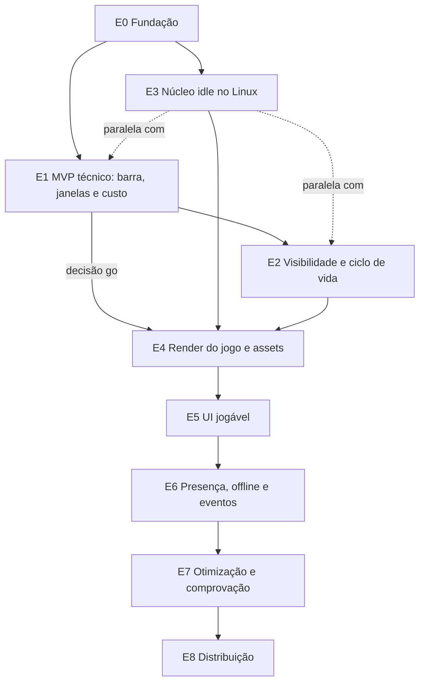

# PLANO — Fase 3: planejamento da execução (jogo idle na barra de tarefas)

**Status:** Rascunho para revisão. Índice geral em [README.md](README.md). Decisões em [DECISOES.md](DECISOES.md) (ADR-001..030 e a **ADR-031**, consolidação em aplicação: sem 2×, acerto instantâneo, configurações editáveis).

Regra: as fichas são a fonte da verdade. O executor não decide arquitetura; se faltar algo, para e reporta. Cada tarefa `T<n>.<m>` equivale a **um commit**, com escopo de arquivos disjunto das demais tarefas que possam rodar em paralelo.

**Regra de ambiente (CLAUDE.md da raiz):** o projeto e todos os workers do tmux rodam **sempre com `claude2` ou `codex`** (ex.: `claude2 --model sonnet --permission-mode bypassPermissions`); nunca com `claude` (Claude Team). Sessão ou worker em `claude` está errado: parar e reabrir.

## 1. Princípios

1. **Riscos de janela e de barra antes das mecânicas.** Primeiro prova-se que a barra de tarefas pode ser lida (UIA), que uma janela layered fica por cima dela, não rouba foco, deixa o clique passar e é barata; só depois se constrói o jogo.
2. **Validar riscos cedo.** Os riscos da seção 2 são atacados na ordem listada, antes de qualquer investimento em conteúdo e arte.
3. **Etapas pequenas.** Cada etapa termina com critérios de aprovação e evidência.
4. **Nada é "passou no Windows" sem evidência.** O Linux (WSL) valida lógica; comportamento Win32, UIA, DPI, foco, DWM e desempenho só valem com registro em `specs/evidencias/E<n>.md` (rótulos "não medido / medido aprovado / medido reprovado", ver README §2.3).
5. **Core isolado.** O que é portável (`net10.0`) é desenvolvido e testado no WSL; o que é `net10.0-windows` compila no WSL e executa no Windows (ADR-012).
6. **Offline e idle são puros.** Presença, economia e retorno offline (ADR-022) são lógica determinística testada no Linux; o Windows só fornece relógio, sessão e janelas.

## 2. Riscos a validar primeiro (em ordem)

| # | Risco | Ficha | Etapa | Critério de decisão |
|---|---|---|---|---|
| R1 | Build WPF/CsWin32 no WSL com `EnableWindowsTargeting` | SDD-02 | E0 | CA-02.1. Se falhar, documentar o fallback de SDD-01 §11 (aprovação do usuário). |
| R2 | **Leitura da barra de tarefas por UIA** (botões como slots; XAML emite eventos? explorer reiniciado; thread MTA `SideWar.Shell`; custo de memória) | SDD-21 | E1 | CA-21.1 a CA-21.9 (MTC-21, `--dump-taskbar`), DP-21.1 validada. Falhas repetidas caem no fallback virtual de 8 slots (ADR-023, RF-21.7); registrar P-22. |
| R3 | **Janela por cima da barra e z-order** (widget sobre `Shell_TrayWnd`, reafirmação de topmost, owner da faixa) | SDD-23 (RF-23.10), SDD-03 (RF-03.6, RF-03.9) | E1 | CA-23.1, CA-23.3, CA-23.7 e CA-22.3: a janela fica acima da barra em ≤ 150 ms após a barra ir ao foreground, com 1 `SetWindowPos` por rajada. |
| R4 | `WS_EX_NOACTIVATE` sem roubar foco com cliques reais | SDD-03, SDD-23 | E1 | CA-03.2 e CA-23.2 (`SendInput`, 100 cliques): `GetForegroundWindow()` não muda. |
| R5 | Custo de CPU/DWM do overlay layered com `UpdateLayeredWindowIndirect` (várias janelas) | SDD-08, SDD-16 | E1 | **Go/no-go da ADR-001.** CA-16.2: se `e1-synthetic` medir CPU de processo + DWM Δ > 2× (3% + 1,5%), abrir a ADR de contingência (DirectComposition) antes da E4. |
| R6 | Alternância `WS_EX_TRANSPARENT` / click-through só na faixa | SDD-04 | E1 | CA-04.1 a CA-04.5 (`WindowFromPoint`, MTC-04.1..3); widget nunca transparente (CA-23.1). |
| R7 | Base de memória do WPF (P-00) | SDD-16 | E1 | P-00 registrado como "medido"; define a base de P-06. |
| R8 | DPI misto, multi-monitor e barra em outra borda ou com ocultação automática (D-12, D-15) | SDD-05, SDD-21 | E1 | CA-05.1 a CA-05.5, CA-21.5, MTC-21.4/5/7/11. |
| R9 | Heurística de fullscreen (Chrome F11/vídeo, VS Code maximizado, barra auto-hide) | SDD-06 | E2 | CA-06.1 a CA-06.4 (matriz MTC-06). |
| R10 | Determinismo Linux × Windows com `LayoutChanged` no meio da partida (ADR-026) | SDD-11, SDD-27, SDD-17 | E3 | CA-11.2 e CA-27.11 (hash igual em 5 execuções, nos dois SOs). Divergência reprova o critério. |
| R11 | Offline analítico: precisão do modelo e custo de 12 h | SDD-25 | E6 | CA-25.5, CA-25.6; P-19 (≤ 50 ms), meta não comprovada. |
| R12 | SkiaSharp nativo em publicação single-file | SDD-18 | E8 (prova rápida na E1) | Na E1, um `dotnet publish` de teste (script descartável, fora do produto) confirma que `libSkiaSharp.dll` carrega; decisão final na E8. |

## 3. Etapas

Convenções das tarefas: **Modelo** sugerido (Haiku para mecânico/repetitivo; Sonnet para lógica e Win32), sempre rodando em `claude2` ou `codex`. **Amb.** = onde roda: WSL ou Windows (via `scripts/wsl/win.sh`). **Ficha/RF** e **Critérios** apontam para as fichas; os arquivos são os projetos da SDD-01, e o executor confere nomes e caminhos na ficha antes de criar. Pelo ADR-031 não há velocidade 2× nem projéteis: o acerto é instantâneo.

### E0: Fundação

**Objetivo:** repositório, solução e projetos vazios compilando; ambiente WSL/Windows reproduzível. **Fichas:** [SDD-01](SDD-01-arquitetura.md), [SDD-02](SDD-02-build-ambiente.md). **Riscos:** R1.

| Tarefa | Descrição (um commit) | Ficha/RF | Modelo | Amb. | Critérios |
|---|---|---|---|---|---|
| T0.1 ✅ | `git init`, `.gitignore`, `.gitattributes`, `.editorconfig` | SDD-02 | Haiku | WSL | CA-02.1 |
| T0.2 ✅ | `global.json` | RF-02.2 | Haiku | WSL | CA-02.1 |
| T0.3 ✅ | `Directory.Build.props` (nullable, warnings como erro, LangVersion, EnableWindowsTargeting) | SDD-01 | Sonnet | WSL | CA-01.1 |
| T0.4 ✅ | `Directory.Packages.props` só com os pacotes de RNF-01.3, versões fixas | RNF-01.3 | Sonnet | WSL | CA-01.4 |
| T0.5 ✅ | Solução `SideWar.slnx` e projetos `src/` vazios com as referências de SDD-01 | SDD-01 | Sonnet | WSL | CA-01.1 |
| T0.6 ✅ | Projetos de teste vazios e teste de arquitetura (referências proibidas) | SDD-01, SDD-17 | Sonnet | WSL | CA-01.2 |
| T0.7 ✅ | Scripts WSL (`build.sh`, `test.sh`, `bench.sh`, `sync-to-windows.sh`, `win.sh`) | SDD-02 | Haiku | WSL | CA-02.2, CA-02.3 |
| T0.8 ✅ | Scripts Windows (`build.ps1`, `test.ps1`, `run.ps1`, esqueletos de `measure-perf.ps1`/`publish.ps1`) | SDD-02 | Haiku | Windows | CA-02.3 |
| T0.9 ✅ | `README.md` da raiz (pré-requisitos RF-02.1) e `specs/evidencias/E0.md` (RF-02.6) | SDD-02 | Haiku | WSL+Windows | CA-02.4, CA-01.3 |

**Aprovação:** CA-01.1 a CA-01.4, CA-02.1 a CA-02.4. **Evidência obrigatória:** `specs/evidencias/E0.md` com saída de `build.sh`, `test.sh` e `win.sh build.ps1` (mostrando `dotnet.exe` e `C:\dev\sidewar`).

### E1: MVP técnico (barra, janelas e custo)

**Objetivo:** provar o que sustenta o jogo: ler a barra de tarefas, ter a janela da faixa e a janela do widget acima dela sem roubar foco, click-through correto, DPI correto, medições iniciais e a **decisão go/no-go**. Nenhuma mecânica de jogo.

**Fichas:** SDD-03 (completo, incluindo RF-03.9); SDD-04; SDD-05; SDD-08 (somente a superfície e o quadro de teste: RF-08.1, RF-08.9, RF-08.10); SDD-10 (somente `RenderPolicy` e `FixedStepper` com simulação falsa); SDD-16 (medição: RF-16.2 cenários `e1-synthetic`, `hidden`, `idle-static`; RF-16.3; RF-16.4 mínimo); **SDD-21** (`TaskbarService`, classificador, slots e `--dump-taskbar`); **SDD-22** (**só a janela da faixa**, RF-22.1, mais um **quadro de teste animado**, sem cena do jogo); **SDD-23** (**só a janela do widget vazia acima da barra**: RF-23.1, RF-23.2 geometria e RF-23.10 z-order, sem conteúdo); SDD-15 (somente bandeja e hotkey mínimas, RF-15.6 e RF-15.7 parciais); SDD-09 apenas o `PlaceholderAtlas` se o quadro de teste exigir. **Riscos:** R2, R3, R4, R5, R6, R7, R8, R12.

Ordem: T1.1, T1.2, T1.3 e T1.7 (paralelas, escopos disjuntos) → T1.4 → T1.5 → T1.6 → (T1.8, T1.9) → T1.10 → T1.11 → T1.12 → T1.13 → T1.14 → T1.15. A **primeira ficha de risco** é T1.4 + T1.7/T1.8 (janela e barra).

| Tarefa | Descrição (um commit) | Ficha/RF | Modelo | Amb. | Critérios |
|---|---|---|---|---|---|
| T1.1 ✅ | `RenderPolicy` e `FixedStepper` em `Core` com `FakeClock` e testes de tabela (sem 2×, ADR-031) | SDD-10 RF-10.5, RF-10.7 | Sonnet | WSL | CA-10.1 a CA-10.3 |
| T1.2 ✅ | `SceneLayout.Compute` (puro) e testes de tabela de monitores/DPI/barra | SDD-22 RF-22.2, SDD-05 | Sonnet | WSL | CA-05.1, CA-22.1 |
| T1.3 ✅ | `NativeMethods.txt` + CsWin32 e utilitários Win32 base | SDD-03, ADR-005 | Sonnet | WSL (compila) | CA-03.5 (base) |
| T1.4 ✅ | GameThread e laço `MsgWaitForMultipleObjectsEx` com waitable timer; contador de wakes | RF-03.1, RF-03.4, RF-03.7, RF-03.8 | Sonnet | Windows | CA-03.3, CA-03.4 |
| T1.5 ✅ | `SceneWindow` (janela da faixa): estilos `LAYERED\|TOOLWINDOW\|NOACTIVATE\|TOPMOST`, sem taskbar/Alt+Tab, sem transições DWM, reafirmação de topmost | RF-03.2, RF-03.5, RF-03.6, RF-22.1 | Sonnet | Windows | CA-03.1, CA-03.2, CA-03.5, CA-22.3 |
| T1.6 ✅ | `LayeredSurface` + `IOverlaySurface` e **quadro de teste animado** a 30 fps, alfa pré-multiplicado | RF-08.1, RF-08.9, RF-08.10 | Sonnet | Windows | CA-08.1, CA-08.2 |
| T1.7 ✅ | `TaskbarClassifier` e `SlotMap` puros (fixtures `centro`, `esquerda`, `com-widgets`, `muitos-apps`, `pequena`) e fallback de 8 slots | SDD-21 RF-21.1, RF-21.4, RF-21.5, RF-21.7, RF-21.8 | Sonnet | WSL | CA-21.1, CA-21.5, CA-21.6 |
| T1.8 ✅ | `TaskbarProbe` (UIA somente leitura, thread MTA `SideWar.Shell`), `TaskbarService`, gatilhos por evento sem polling e **`--dump-taskbar`** | SDD-21 RF-21.2, RF-21.3, RF-21.6, RF-21.9 | Sonnet | Windows | CA-21.2, CA-21.3, CA-21.4, CA-21.7 a CA-21.9 |
| T1.9 ✅ | **Janela do widget vazia** (420×48 DIP) acima da barra: owner = faixa, geometria na zona livre ou fallback, z-order sobre `Shell_TrayWnd`, sem `TRANSPARENT` | RF-03.9, RF-23.1, RF-23.2, RF-23.10, RF-23.11 | Sonnet | Windows | CA-23.1, CA-23.3, CA-23.7 |
| T1.10 ✅ | Geometria por monitor, DPI PMv2 (manifesto), reação a `WM_DPICHANGED`/`WM_DISPLAYCHANGE`/barra de tarefas | SDD-05 | Sonnet | Windows | CA-05.2 a CA-05.5 |
| T1.11 ✅ | Modos Passivo/Interativo só da faixa, regiões clicáveis, "peek", retorno em 8 s | SDD-04 | Sonnet | Windows | CA-04.1 a CA-04.5 |
| T1.12 ✅ | `HotkeyService` (`ToggleInteractive`, `ToggleVisibility`) e bandeja mínima | SDD-15 RF-15.6, RF-15.7 (parciais) | Sonnet | Windows | CA-15.4 (parcial) |
| T1.13 ✅ | Modo `--bench` (`e1-synthetic` com a faixa + widget, `hidden`, `idle-static`), CSV, diagnóstico mínimo, `baseline-wpf` | SDD-16 RF-16.2, RF-16.4, RF-16.5, P-00 | Sonnet | Windows | CA-16.1 |
| T1.14 🟡 | `measure-perf.ps1` completo, `machine.json`, `summary.json` | SDD-16 RF-16.3 | Sonnet | Windows | CA-16.1 (medição oficial 5 min×N pendente; amostra curta apenas) |
| T1.15 | Prova de publish single-file com SkiaSharp (R12, descartável); checklists `MTC-03`, `MTC-04`, `MTC-05`, `MTC-21`, `MTC-22` (itens 1 a 2, 8 a 9) e `MTC-08.1`; `specs/evidencias/E1.md` com a decisão | SDD-03, 04, 05, 21, 22 | Haiku | Windows | CA-21.2, CA-16.2 |

**Aprovação:** CA-03.1 a CA-03.5, CA-04.1 a CA-04.5, CA-05.1 a CA-05.5, CA-08.1, CA-08.2, CA-10.1 a CA-10.4, CA-21.1 a CA-21.9, CA-22.1, CA-22.3 (janela), CA-23.1, CA-23.3, CA-23.7, CA-16.1, **CA-16.2 (go/no-go)**. **Evidência obrigatória:** `specs/evidencias/E1.md` com TRX Linux e Windows (incluindo T-03.2, T-04.1 e T-21.x), MTC-03/04/05/21 preenchidos com capturas, saída de `--dump-taskbar` do Windows 11 do usuário, P-00, P-01, P-02, P-11, P-12 e P-22 rotulados como medido, `machine.json` (D-05) e **decisão registrada: go ou abrir ADR de contingência**. Sem essa decisão, a E4 não começa.

**Nota de alinhamento:** o cabeçalho da SDD-23 declara "Etapa E5"; o corte da E1 (somente a janela vazia, RF-23.1, RF-23.2, RF-23.10) vem deste plano e precisa constar no cabeçalho da ficha.

### E2: Visibilidade e ciclo de vida

**Objetivo:** o overlay se oculta e volta sozinho com segurança, e encerra sem resíduo; as configurações persistem. **Fichas:** [SDD-06](SDD-06-deteccao-fullscreen.md); [SDD-07](SDD-07-ciclo-de-vida.md) (sem os ganhos offline e os eventos, que entram na E6); [SDD-14](SDD-14-persistencia.md) (somente `AtomicFileWriter` e `SettingsStore`, com configurações editáveis, ADR-031). **Riscos:** R9.

| Tarefa | Descrição (um commit) | Ficha/RF | Modelo | Amb. | Critérios |
|---|---|---|---|---|---|
| T2.1 ✅ | `FullscreenClassifier` (puro) com fixtures reais e testes de tabela | SDD-06 | Sonnet | WSL | CA-06.1 |
| T2.2 ✅ | `FullscreenWatcher` por eventos (`SetWinEventHook`), histerese, `SameMonitor`; oculta faixa, widget e hotspots | SDD-06, RF-23.11 | Sonnet | Windows | CA-06.3, CA-06.4, CA-22.9 |
| T2.3 ✅ | `AppStateMachine`, `HiddenReason`/`PauseReason` e testes de transições | SDD-07 | Sonnet | WSL | CA-07.1 |
| T2.4 ✅ | `AtomicFileWriter` + `SettingsStore` (schema versionado, `.bak`, `corrupt\`) | RF-14.2, RF-14.3, RF-14.4, RF-14.9 | Sonnet | WSL | CA-14.2, CA-14.3 (Settings) (+ T2.4b: FakeFileSystem normaliza separadores no Windows) |
| T2.5 ✅ | Instância única, sessão (lock/unlock, suspensão, logoff), perfis de energia e inatividade | SDD-07 | Sonnet | Windows | CA-07.2 a CA-07.5 (parcial) |
| T2.6 ✅ | Encerramento seguro e `crash-*.txt` | SDD-07 | Sonnet | Windows | CA-07.3, CA-07.6 |
| T2.7 | Checklists `MTC-06`, `MTC-07`, evidência E2 e medição `hidden` | SDD-06, 07, 16 | Haiku | Windows | CA-06.2, CA-07.7 |

**Aprovação:** CA-06.1 a CA-06.4, CA-07.1 a CA-07.7 (CA-07.2, 07.3 e 07.5, que dependem de sessão e offline completos, ficam "parcial" na E2 e fecham na E6), CA-14.2 e CA-14.3 aplicados a `SettingsStore`. **Evidência obrigatória:** `specs/evidencias/E2.md` com a matriz MTC-06 100% preenchida, TRX Linux e Windows e P-01 medido.

### E3: Núcleo idle no Linux

**Objetivo:** simulação idle determinística completa no Core, testada no WSL. **Roda em paralelo com E1/E2** (só toca `Core` e `tests/Core`). **Fichas:** [SDD-12](SDD-12-torres-inimigos-ondas.md) (formato de conteúdo e validador); [SDD-11](SDD-11-combate.md) (mundo 1D, acerto instantâneo, `LayoutChanged`); [SDD-27](SDD-27-economia-idle.md) (**economia**, RF-27.1 a RF-27.9 e RF-27.12 a RF-27.14; a parte de missões, regiões e prestígio é E6); SDD-10 (integração com a simulação); SDD-13 (só o stub da economia e `stageTopic`); SDD-17 (benchmarks de simulação). **Riscos:** R10.

| Tarefa | Descrição (um commit) | Ficha/RF | Modelo | Amb. | Critérios |
|---|---|---|---|---|---|
| T3.1 ✅ | Modelo de conteúdo JSON (`towers.json`, inimigos, ondas, fases), validador e carga | SDD-12, RF-27.14 | Sonnet | WSL | CA-12.1 |
| T3.2 ✅ | `CreditFormatter` pt-BR (ADR-029) e `RateMeter` | RF-27.2, RF-27.3 | Sonnet | WSL | CA-27.1, CA-27.10 |
| T3.3 ✅ | `IdleWaveBuilder`: HP, ouro, XP e mistura por onda; chefes nas ondas 20, 40, 60, 80 e 100 | RF-27.6, RF-27.7, SDD-12 | Sonnet | WSL | CA-12.2, CA-27.3, CA-27.4 |
| T3.4 ✅ | `SimState`, handles e stores O(1); layout da faixa como estado (`LayoutChanged` entre ticks, ADR-026) | SDD-11 RF-11.3 | Sonnet | WSL | CA-11.1 |
| T3.5 ✅ | Ordem do tick, mira 1D por slots e **acerto instantâneo** (ADR-027) | SDD-11 | Sonnet | WSL | CA-11.1 |
| T3.6 ✅ | Dano, armadura, chilled, splash, super hit e eventos (números de dano) | SDD-11 | Sonnet | WSL | CA-11.1 |
| T3.7 ✅ | Comandos (construir, melhorar), `LayoutChanged` e `StateHash` | SDD-11, RF-27.5 | Sonnet | WSL | CA-11.1, CA-27.2 |
| T3.8 ✅ | Núcleo, queda e recuo; fases, estrelas, XP e nível; conclusão de fase | RF-27.8, RF-27.9 | Sonnet | WSL | CA-27.5 a CA-27.7 |
| T3.9 ✅ | Economia mínima de SDD-13 (stub) e `stageTopic` em `stages.json` — absorvida: stageTopic entregue na T3.1; stub IEconomy migrado para a série T3.5–T3.8 | SDD-13 RF-13.3 | Haiku | WSL | CA-27.6 |
| T3.10 ✅ | `SanityBot` idle e 3 partidas de replay (uma de 200 ondas, com `LayoutChanged`) | SDD-11, SDD-12, RF-27.15 | Sonnet | WSL | CA-11.2, CA-12.3, CA-27.11 |
| T3.11 ✅ | Integração do `GameHost` com a simulação (passo fixo de 30 Hz, ondas automáticas) | SDD-10 | Sonnet | WSL | CA-10.2, CA-10.3 (+ TU.1: integração host/eventos/ausente/offline) |
| T3.12 ✅ | Benchmarks de simulação (tick médio e p99, alocação) | SDD-17, P-13 | Haiku | WSL | CA-11.3 (indicativo) |
| T3.13 ✅ | Cobertura ≥ 90% do Core e `specs/evidencias/E3.md` | SDD-17 | Haiku | WSL | CA-11.4 (cobertura 98,19% sem código gerado) |

T3.4 a T3.8 compartilham contratos de `SimState`: **não paralelizar entre si** (seção 4). T3.1 a T3.3 podem ser paralelas.

**Aprovação:** CA-10.1 a CA-10.3 (integração), CA-11.1, CA-11.2 e CA-27.11 (**no Windows também**: o hash cruzado só fecha quando a E3 for rodada no Windows via `win.sh test.ps1`), CA-11.4, CA-12.1 a CA-12.3, CA-27.1 a CA-27.7, CA-27.10. **Evidência obrigatória:** `specs/evidencias/E3.md` com TRX Linux e Windows, hashes das 3 partidas em 5 execuções nos dois SOs, resultado do bot e benchmark rotulado como indicativo. Balanceamento (D-10) por JSON.

### E4: Render do jogo e assets

**Objetivo:** o jogo simulado aparece na faixa com o visual oficial e custo medido. **Fichas:** [SDD-09](SDD-09-sprites-assets.md) (**exportação dos 13 sprites do design** e atlas); [SDD-20](SDD-20-sistema-visual.md) (tokens, fontes Silkscreen e JetBrains Mono, ícones, animações); SDD-08 (completo); [SDD-22](SDD-22-faixa-de-batalha.md) (**cena completa**, RF-22.3 a RF-22.10). **Pré-requisitos:** E1 com decisão **go** e E3 aprovada; D-03 e D-13 respondidas.

| Tarefa | Descrição (um commit) | Ficha/RF | Modelo | Amb. | Critérios |
|---|---|---|---|---|---|
| T4.1 ✅ | Exportação dos 13 PNG do design para `assets/source/design/` com `MANIFEST.json` (Scale Set placeholder, D-13) | SDD-22 RF-22.9 | Haiku | WSL | CA-22.10, CA-09.6 |
| T4.2 ✅ | `AssetPipeline` (atlas, manifesto) com hash estável | SDD-09 | Sonnet | WSL | CA-09.1, CA-09.2 |
| T4.3 ✅ | `ScaledSpriteCache.Bake` e `PlaceholderAtlas` (+ T4.3b: atlas embutido com fallback de placeholder) | SDD-09 | Sonnet | WSL | CA-09.3, CA-09.4 |
| T4.4 ✅ | `Palette` (tokens), sombra dura e contraste | SDD-20 RF-20.1, RF-20.8 | Sonnet | WSL | CA-20.1, CA-20.3, CA-20.7 |
| T4.5 ✅ | Fontes (`Edging = Alias`, tamanho físico inteiro) e ícones vetoriais | SDD-20 | Sonnet | WSL | CA-20.2, CA-20.4, CA-20.5 |
| T4.6 ✅ | `SceneGeometry` e camadas de cena (núcleo, torres por slot, portal, inimigos, números de dano) | SDD-22 RF-22.4, RF-22.5 | Sonnet | WSL | CA-22.2 |
| T4.7 ✅ | Animações (`adMarch`, `adBlink`, `adPulse`, `adBob`) e `reducedMotion` | SDD-20, RF-22.10 | Sonnet | WSL | CA-20.6, CA-22.8 |
| T4.8 ✅ | Golden images `strip-present`, `strip-away`, `strip-peak`, `strip-boss`, `strip-fallback`, `strip-empty-slots` a 100% e 150% | SDD-22 CA-22.7, SDD-17 RF-17.3 | Sonnet | WSL | CA-22.7, CA-08.3 |
| T4.9 ✅ | Linha de borda de estado, **modo ausente** (selo click-through) e janelas hotspot (banners e caixas) | RF-22.6 a RF-22.8 | Sonnet | Windows | CA-22.5, CA-22.6 |
| T4.10 | Integração `GameHost` + simulação + render + `RenderPolicy` por presença (presente 30 fps, ausente 8 fps) | SDD-10, SDD-08 | Sonnet | Windows | CA-08.4, CA-10.3 |
| T4.11 | Cenários `presente-onda`, `ausente` e `varias-janelas` do `--bench` com o `SanityBot` | SDD-16 RF-16.2 | Sonnet | Windows | CA-16.5 (parcial) |
| T4.12 | Medição P-11 e P-12 (primeira passada), P-17 e P-18, memória do atlas e `specs/evidencias/E4.md` | SDD-16, SDD-09 | Haiku | Windows | CA-09.5, CA-22.9 |

**Aprovação:** CA-08.3, CA-08.4, CA-09.1 a CA-09.6, CA-20.1 a CA-20.7, CA-22.1 a CA-22.10. Metas de desempenho são registradas (aprovadas ou reprovadas), sem bloquear; a comprovação final é da E7. **Evidência obrigatória:** `specs/evidencias/E4.md` com golden images no Linux e no Windows, memória do atlas e CSVs dos cenários.

### E5: UI jogável

**Objetivo:** partida idle jogável só com o mouse: widget com conteúdo, painel de 4 abas, bandeja e configurações, e ZIP interno para playtest. **Fichas:** [SDD-23](SDD-23-widget-hud.md) (completo); [SDD-24](SDD-24-painel-e-cards.md) (painel e cards); [SDD-15](SDD-15-interface-controles.md) (bandeja, menu nativo, atalhos, `SettingsWindow` com configurações editáveis e `AboutWindow`); playtest e ajustes de balanceamento só por JSON; ZIP interno de SDD-18 (passos 1 a 4 de `publish.ps1`). As abas **Missões** e **Migrar** nascem ligadas a dados de teste até a E6.

| Tarefa | Descrição (um commit) | Ficha/RF | Modelo | Amb. | Critérios |
|---|---|---|---|---|---|
| T5.1 ✅ | Conteúdo do widget: créditos e taxa, onda, selo de presença, nav de 4 botões | SDD-23 RF-23.3 a RF-23.7 | Sonnet | WSL | CA-23.4, CA-23.5, CA-23.10 |
| T5.2 🟡 | Hit-test, cursores, `NotifyInteraction`, render por evento e menu de clique direito | SDD-23 RF-23.8, RF-23.9 | Sonnet | Windows | CA-23.2, CA-23.6, CA-23.8, CA-23.9, CA-23.11 (CA Windows interativos pendentes: mouse físico, cursor, MTC-23.2/23.5, DPI) |
| T5.3 🟡 | Três janelas layered do painel e dos cards: estilos, geometria, rolagem e hover | SDD-24 | Sonnet | Windows | CA-24.1 a CA-24.3, CA-24.9, CA-24.12, CA-24.16 (reposicionamento por DPI/DISPLAYCHANGE ainda não ligado ao host) |
| T5.4 ✅ | Abas Arsenal e Campanha (construir, melhorar, `SEM SLOT`, auto-escala visual) | SDD-24, RF-27.5 | Sonnet | WSL | CA-24.4 a CA-24.6, CA-24.14 |
| T5.5 ✅ | Abas Missões e Migrar (visual, com dados de teste) e card de pergunta (visual) | SDD-24 | Sonnet | WSL | CA-24.7, CA-24.8, CA-24.10, CA-24.15 |
| T5.6 | Golden images do widget, do painel e dos cards | SDD-23, SDD-24, SDD-17 | Sonnet | WSL | CA-23.4, CA-24.13 |
| T5.7 ✅ | Atalhos completos e `HotkeyParser` | SDD-15 RF-15.6 | Sonnet | Windows | CA-15.4 |
| T5.8 🟡 | Menus nativos (`TrackPopupMenuEx`) e bandeja completa | SDD-15 RF-15.7, RF-15.8 | Sonnet | Windows | CA-15.5, CA-15.6 (CA-15.5 foco real e CA-15.6 explorer real pendentes) |
| T5.9 🟡 | `SettingsWindow` (configurações editáveis, ADR-031) e `AboutWindow`, abertas só por ação do usuário | SDD-15 RF-15.9, SDD-14 RF-14.4 | Sonnet | Windows | ADR-015, CA-14.2 (Settings) (CA Windows interativos pendentes) |
| T5.10 ✅ | `publish.ps1` mínimo para o ZIP interno | SDD-18 | Haiku | Windows | CA-18.1 (parcial) |
| T5.11 | Playtest, ajustes só em `content/*.json`, MTC-22/23/24 e `specs/evidencias/E5.md` | SDD-22, 23, 24, 27 | Haiku | Windows | CA-22.3, CA-23.2, CA-24.2 |

**Aprovação:** CA-23.1 a CA-23.11, CA-24.1 a CA-24.16, CA-15.4 a CA-15.6. **Evidência obrigatória:** `specs/evidencias/E5.md` com a partida idle jogada só com o mouse (VS Code em foco o tempo todo, sem mudar o foco), registro dos ajustes de JSON e resultado do playtest (D-10).

### E6: Presença, offline e eventos

**Objetivo:** presença, retorno offline analítico, eventos ao vivo, missões, prestígio e persistência completa. **Fichas:** [SDD-25](SDD-25-presenca-e-offline.md); [SDD-26](SDD-26-eventos-ao-vivo.md); [SDD-13](SDD-13-progressao.md) (só `stageTopic` e `Profile` ajustado); SDD-14 (completo); SDD-27 (RF-27.10 e RF-27.11: regiões, prestígio e missões); SDD-07 (fecha os gatilhos de save e o offline na sessão).

| Tarefa | Descrição (um commit) | Ficha/RF | Modelo | Amb. | Critérios |
|---|---|---|---|---|---|
| T6.1 ✅ | `PresenceTracker` e `PresenceMultiplier` (5 min, ×1,5/×2,0/×2,5/×0,25) | SDD-25 RF-25.1, RF-25.3 | Sonnet | WSL | CA-25.1, CA-25.2 |
| T6.2 ✅ | Modo Ausente (simulação real a 8 fps) e `AutoScaler` | RF-25.4, RF-25.5 | Sonnet | WSL | CA-25.3, CA-25.4, CA-25.8 |
| T6.3 ✅ | `OfflineCalculator` e `OfflineReport` (analítico, teto de 12 h) | RF-25.6 a RF-25.8 | Sonnet | WSL | CA-25.5, CA-25.6 |
| T6.4 | Card "Bem-vindo de volta" (lógica, COLETAR ×2, recolhimento em 60 s) e aplicação do resultado (D-11) | RF-25.9, RF-25.10, SDD-24 | Sonnet | Windows | CA-25.7, CA-24.11 |
| T6.5 ✅ | `EventScheduler`, pico de demanda e caixas de suprimentos | SDD-26 RF-26.2, RF-26.3, RF-26.11, RF-26.12 | Sonnet | WSL | CA-26.1, CA-26.5, CA-26.6 |
| T6.6 ✅ | Chefe com pergunta Azure, `QuestionLedger`, banco `questions.json` e validador | RF-26.4 a RF-26.10 | Sonnet | WSL | CA-26.2 a CA-26.4, CA-26.7, CA-26.8 |
| T6.7 ✅ | `PrestigeService` ("Migrar", regiões) e `MissionService` | SDD-27 RF-27.10, RF-27.11, RF-27.13 | Sonnet | WSL | CA-27.8, CA-27.9 |
| T6.8 ✅ | `ProfileStore` e `SessionStore` (`OfflineSnapshot`) com schemas versionados e migrações | SDD-14 RF-14.5, RF-14.6, RF-14.10, RF-25.11 | Sonnet | WSL | CA-14.1, CA-14.4, CA-14.6, CA-25.9 |
| T6.9 🟡 parte A (T6.9a) | Gatilhos de save, limite de gravações e integração de sessão/suspensão/logoff com o offline | SDD-14 RF-14.7, RF-14.8, SDD-07 | Sonnet | Windows | CA-14.5, CA-07.2, CA-07.5 |
| T6.10 ✅ | Teste de kill do processo em loop | SDD-14 | Sonnet | Windows | CA-14.2 |
| T6.11 | Ligar as abas Missões e Migrar, banners, caixas e card de pergunta aos serviços reais | SDD-24, SDD-26 | Sonnet | Windows | CA-26.9, CA-24.7, CA-24.8 |
| T6.12 | Fechamento de CA-07.2, CA-07.3 e CA-07.5, MTC-07, cobertura (Runtime e Persistence) e `specs/evidencias/E6.md` | SDD-07, 14, 17 | Haiku | Windows | CA-07.3, CA-17.3 |

**Aprovação:** CA-25.1 a CA-25.9, CA-26.1 a CA-26.9, CA-27.8, CA-27.9, CA-14.1 a CA-14.6, CA-07.2, CA-07.3, CA-07.5, CA-24.11, CA-17.3. **Evidência obrigatória:** `specs/evidencias/E6.md` com TRX Linux e Windows, MTC-07.1..3 completos e a medição de P-19 (retorno de 12 h).

### E7: Otimização e comprovação

**Objetivo:** comprovar todas as metas de desempenho. **Fichas:** SDD-16 (P-00 a P-22); atualização parcial de RF-08.7 **sob benchmark**; alocação 0 B/frame (CA-08.5); soak de 2 h.

| Tarefa | Descrição (um commit) | Ficha/RF | Modelo | Amb. | Critérios |
|---|---|---|---|---|---|
| T7.1 | Rodada completa de medição P-00..P-22 e `specs/evidencias/perf/` | SDD-16 | Haiku | Windows | CA-16.3, CA-16.5 |
| T7.2 | Correções de alocação até 0 B/frame e `RenderAllocationTests` | SDD-08 RNF-08.3 | Sonnet | WSL+Windows | CA-08.5 |
| T7.3 | Atualização parcial (dirty rect) de RF-08.7, só com benchmark que a justifique | SDD-08 RF-08.7 | Sonnet | Windows | CA-16.3 |
| T7.4 | Ajustes de GC e configuração de runtime | SDD-16 RF-16.6 | Sonnet | Windows | CA-16.3 |
| T7.5 | Soak de 2 h (P-07) | SDD-16 | Haiku | Windows | CA-16.3 |
| T7.6 | Conferência do inventário de segundo plano (UIA, `SideWar.Shell`, timers) com o código | SDD-16 RF-16.8 | Sonnet | WSL | CA-16.4 |

**Aprovação:** CA-16.3, CA-16.4, CA-16.5, CA-08.5, CA-07.7. **Evidência obrigatória:** todas as metas com rótulo medido aprovado ou reprovado; cada reprovada com correção ou ADR de revisão aprovada pelo usuário. Depende de D-05.

### E8: Distribuição

**Objetivo:** pacote que roda em Windows limpo. **Ficha:** [SDD-18](SDD-18-distribuicao.md). **Riscos:** R12 (decisão final). **Depende de:** D-04 e D-09.

| Tarefa | Descrição (um commit) | Ficha/RF | Modelo | Critérios |
|---|---|---|---|---|
| T8.1 ✅ | Perfil de publicação `win-x64` single-file e versionamento (`--version`) | RF-18.1, RF-18.2 | Sonnet | CA-18.1, CA-18.5 |
| T8.2 | `scripts/windows/publish.ps1` (build, testes, publish, ZIP, `SHA256SUMS.txt`) | RF-18.3 | Sonnet | CA-18.1 |
| T8.3 🟡 | `LICENSE.txt`, `THIRD-PARTY-NOTICES.txt` (SkiaSharp, .NET, Silkscreen e JetBrains Mono OFL, assets conforme D-03) e `README.txt` | RF-18.3, RF-18.7 | Haiku | CA-18.1 (LICENSE do projeto pendente de decisão) |
| T8.4 | Verificação do pacote (extrair, `--bench idle-static`, `--version`, `--diag`) e zero rede (ADR-014) | RF-18.3, RF-16.2 | Sonnet | CA-18.1, CA-18.4 |
| T8.5 | Instalação por ZIP e remoção limpa; Windows Sandbox/VM sem .NET | RF-18.5, RF-18.7 | Haiku | CA-18.2, CA-18.3 |
| T8.6 | Assinatura opcional (só com certificado, D-04) | RF-18.4 | Sonnet | CA-18.1 |
| T8.7 | P-08 e P-00 nas variantes comprimida e não comprimida, com ADR da escolha | RF-18.2 | Haiku | CA-18.5 |
| T8.8 | ADR do caminho da v1 (MSIX, Velopack ou Inno Setup), **só após D-04** e antes de implementar | RF-18.6 | Sonnet | CA-18.5 |

**Aprovação:** CA-18.1 a CA-18.5. **Evidência:** `specs/evidencias/E8.md` com MTC-18.1 (zero rede), MTC-18.2 (Windows Sandbox/VM sem .NET) e MTC-18.3 (remoção limpa), P-08 e P-00 nas duas variantes e ADR da escolha.

(A antiga E9, módulo Azure opcional, foi eliminada: perguntas e picos são núcleo, ADR-024, e entram na E6 via SDD-26. A [SDD-19](SDD-19-modulo-azure.md) é histórica.)

## 4. Ordem e paralelismo das etapas

Regras de paralelismo:

1. E3 roda em paralelo com E1/E2, pois só toca `Core` e `tests/Core`. Qualquer tarefa de E1/E2 que precise mexer em `Core` (ex.: T1.1 `RenderPolicy`/`FixedStepper`, `Core/Loop/*`) deve **terminar antes** de T3.4 começar, ou usar subpasta distinta.
2. **Não paralelizar tarefas que tocam os mesmos arquivos ou contratos** (ex.: T3.4 a T3.8 compartilham `SimState`; T1.5, T1.6 e T1.9 compartilham o contrato `IOverlaySurface` e o conjunto de janelas de RF-03.9).
3. Tarefas paralelas devem ter escopos de arquivo disjuntos, declarados na tabela. Se dois escopos se sobrepõem, a tarefa fica em série.
4. Qualquer mudança em contrato público de `Core` ou `Platform.Windows` exige uma tarefa própria, em série, antes dos consumidores.
5. Etapa sem evidência registrada não está concluída, e a seguinte não começa (exceção: E3 em paralelo).
6. Workers sempre em `claude2` ou `codex` (CLAUDE.md); um worker aberto com `claude` é descartado e reaberto.

## 5. Marcos

**MVP técnico = E0 + E1 + E2.** Definição de pronto:

- a barra de tarefas é lida por UIA (ou cai no fallback de 8 slots) e `--dump-taskbar` funciona (CA-21.x);
- a faixa (com quadro de teste animado) e a janela do widget vazia ficam acima da barra, fora do Alt+Tab, sem roubar foco, com o widget acima de `Shell_TrayWnd` (CA-03.x, CA-23.1, CA-23.3, CA-23.7);
- click-through da faixa e modo interativo funcionando (CA-04.x), DPI e multi-monitor corretos (CA-05.x);
- oculta sozinho em fullscreen real e permanece com maximizado (CA-06.x); ciclo de vida seguro (CA-07.x, com os fechamentos de save e offline na E6);
- P-00, P-01, P-02, P-11, P-12 e P-22 medidos e **decisão go/no-go da ADR-001 registrada**;
- `specs/evidencias/E0.md`, `E1.md` e `E2.md` completos.

**MVP jogável = até E5**: jogo idle visível na barra, com widget e painel, torres nos botões de aplicativos, ondas automáticas, melhorias só com o mouse e sem mudar o foco, com ZIP interno para playtest. Presença, offline, eventos e persistência completa (E6), metas comprovadas (E7) e distribuição (E8) vêm depois.

## 6. Decisões pendentes (de DECISOES.md)

D-01 (resolvido por ADR-024), D-02 (obsoleto, ADR-020) e D-07 (obsoleto, ADR-019) não bloqueiam nada. As demais:

| ID | Questão | Recomendação do Tech Lead | Bloqueia (ficha) | Bloqueia (etapa) |
|---|---|---|---|---|
| D-03 | Direitos dos assets exportados do design e das fontes Silkscreen e JetBrains Mono (TTF fornecidos pelo usuário, ADR-025) | Aceitar a exportação do artefato e as fontes OFL | SDD-09 (importação), SDD-20 | E4 (T4.1, T4.5) |
| D-04 | Canal de distribuição e certificado de assinatura | ZIP portátil no MVP; v1 em MSIX assinado se houver certificado; senão Velopack ou Inno Setup | SDD-18 | E8 (T8.6, T8.8) |
| D-05 | Máquina de referência para as metas de desempenho | O usuário informa CPU, GPU, RAM, build do Windows 11, monitores e DPI | Aprovação das metas medidas (SDD-16) | Aprovação de E1 (rótulos "medido") e E7 |
| D-06 | Áudio no desktop | Pós-MVP, desligado por padrão, buffers PCM sintetizados | Seção de áudio de SDD-15 | Nenhuma etapa do MVP (pós-E8) |
| D-08 | Duração das fases (substituído pelas fases idle de SDD-27 RF-27.9) | Manter SDD-27 e rever após playtest (D-10) | SDD-27 | Nenhuma (fechado em D-10) |
| D-09 | Nome do produto, executável e pasta de dados | "SideWar Desktop", `SideWar.exe`, `%LOCALAPPDATA%\SideWar` | SDD-18 | E8 |
| D-10 | Calibração da economia idle (custos, ganhos, multiplicadores) | Valores iniciais de SDD-27, ajustados por JSON após playtest | SDD-27, SDD-12 (balanceamento final) | E5 (playtest, T5.11) e fechamento na E6 |
| D-11 | Card "Bem-vindo de volta" aparecer sozinho (janela não ativável) | Aparecer sozinho, sem ativar a janela (ADR-015 refinada) | SDD-25 RF-25.9, SDD-24 | E6 (T6.4) |
| D-12 | Barra não inferior ou com ocultação automática | Fallback virtual já especificado (SDD-21 RF-21.7, SDD-22 RF-22.1) | SDD-21, SDD-22 (aceite em barra não inferior) | E1 (T1.8, MTC-21.4/11) |
| D-13 | Sprite próprio do Scale Set (hoje placeholder) | Criar o sprite no design; enquanto isso, placeholder no MANIFEST | SDD-22 RF-22.9 (assets) | E4 (T4.1) |
| D-14 | Títulos das fases 08 a 10 (provisórios) | Aceitar os provisórios de SDD-27 (DP-27.10) até o usuário definir | SDD-27 (conteúdo) | E3 (T3.1, usa provisórios) e E6 (`stages.json` final) |
| D-15 | Barra com Widgets/Copilot ocupando a zona esquerda | O widget HUD vai para a faixa (fallback de SDD-23 RF-23.2) | SDD-23 (posição do widget) | E1 (T1.9) |
| D-16 | Selo de presença do widget não cabe em 420 DIP | Selo só com "×2,0"/"×0,25", cor e borda indicando o estado, rótulo completo no nome acessível | SDD-23 (layout final do selo) | **E5** (bloqueia o layout final do widget; ADR-032) |
| D-17 | Fundo próprio do widget (`bg-painel` alfa 230, borda, raio 4), inexistente no design | Aprovar | SDD-23, SDD-20 | E5 |
| D-18 | Recompensa das missões em renda relativa vs valor fixo do design (+12K) | Renda relativa | SDD-27 (DP-24.7), SDD-24 | E6 (missões) |

Observação: D-05 não bloqueia o início de nenhuma etapa, mas **sem ela, nenhum rótulo "medido aprovado" é válido**.

## 7. Primeira ficha recomendada

1. **E0 (SDD-01 + SDD-02)** como pré-requisito mecânico: repositório, solução, scripts e verificação do build WPF no WSL (R1). Baixo risco, alto desbloqueio.
2. Em seguida, **SDD-03 + SDD-21 em paralelo**, as duas fichas de risco real:
   - **SDD-03** (T1.3 a T1.5): GameThread, janela da faixa, não roubar foco e topmost, onde se prova ou invalida a ADR-001 (riscos de janela e z-order);
   - **SDD-21** (T1.7 e T1.8): classificador e slots puros no WSL, depois UIA e `--dump-taskbar` no Windows (risco de barra). Escopos disjuntos (`Platform.Windows/Windows/*` × `Platform.Windows/Taskbar/*` e `Runtime/Taskbar/*`); T1.8 só começa depois de T1.4.

Em paralelo, pode começar a **E3** (SDD-12, SDD-11 e SDD-27 no Core), pois não depende de Windows.

## 8. Revisão ADR-033: fichas propostas (decisão registrada como ADR-034)

> **Origem:** ficha SPEC-ADR033 (2026-11-13). A decisão do usuário foi registrada como **ADR-034** em DECISOES.md (o número ADR-033 já pertence a `IOverlaySurface`, T1.6). Nada nesta seção altera as linhas anteriores do plano: ela **propõe** fichas novas e aponta o retrabalho das já feitas. As propostas DP-33.x (SDD-21 seção 11) foram **Aceitas (Tech Lead, 2026-11-13)**, assim como a caixa entre núcleo e portal (TA.12 liberada), o fantasma inválido em laranja, o clique no painel cancelando o modo construção e o banner de pico/chefe oculto durante o modo. Regra de ambiente inalterada: workers sempre com `claude2` ou `codex`.

### 8.1 Fichas novas (série TA)

| ID sugerido | Escopo (um commit) | Ficha/RF | Depende de | Amb. | Critérios |
|---|---|---|---|---|---|
| TA.1 | **Spike de z-order e clique sobre a barra** (descartável, antes de qualquer render): janela layered topmost cobrindo a barra com 3 torres de teste nas zonas livres; medir o reaparecimento após clicar em ícone, Iniciar, pesquisa, bandeja e miniaturas; clique passante em Passivo e Interativo; recomendação registrada para DP-33.4 (`towersInBar` padrão) | SDD-22 RF-22.1, RNF-22.11; SDD-21 DP-33.4 | T1.5, T1.11 | Windows | MTC-21.13, MTC-22.11, T-22.14; `specs/evidencias/TA.1.md` |
| TA.2 🟡 | `TaskbarClassifier` com `Blocked` (margens 4/16) e `BuildZoneMap` (`Taskbar`/`Band`, descarte < 44, máx. 8 zonas); fixture sintética do canvas; `--dump-taskbar` grava `Blocked` e `BuildZones`; captura manual de `taskbar-centro-apps-abertos` | SDD-21 RF-21.1, RF-21.5, RF-21.7, RF-21.9 | DP-33.3, DP-33.5, DP-33.6 | WSL (+ captura Windows) | CA-21.1, CA-21.5, T-21.1 a T-21.3, CA-21.9 (captura manual interativa de `taskbar-centro-apps-abertos` pendente) |
| TA.3 ✅ | Core: `Tower` com `Anchor`/`OffsetDip`/`Placed`; `StripLayout` com `Width`/`Host`/`FreeZones`; `PlacementValidator` 1D; `LayoutChanged` com reavaliação por `Id`; `BuildTower(type, x)`, `PlaceTower(id, x)`, `AutoPlaceUnpositioned()`; `TowerStore` 32 e limite 24; `StateHash`; regeneração dos replays do `SanityBot` | SDD-11 RF-11.2, 11.3, 11.9, 11.10, 11.12; SDD-27 RF-27.5; SDD-21 RF-21.8 | DP-33.1, DP-33.2, DP-33.3, DP-33.7 | WSL | CA-11.1, CA-11.2, T-11.10, T-11.13, T-21.4 |
| TA.4 ✅ | Persistência e offline: `sidewar.session` +1 com migração de `slotIndex` (DP-33.7), `anchor`/`offsetDip`/`placed`/`freeZones`/`migratedSlots`; `OfflineTower` e auto-escala só com torres posicionadas | SDD-14 RF-14.10, CA-14.6; SDD-25 (DPS) | TA.3 | WSL | CA-14.6, T-14.8, CA-25.5 |
| TA.5 🟡 | `SceneLayout.Compute` novo (cena 104 DIP + barra; hospedeiro `Band`); `SceneWindow` redimensionada sobre a barra; `ZOrderCoordinator` passa a reafirmar a cena com os gatilhos da barra; host emite `LayoutChanged` a partir do `BuildZoneMap` | SDD-22 RF-22.1, RF-22.2; SDD-05 RNF-05.3; SDD-03 RF-03.9 | TA.1, TA.2 | WSL (puro) + Windows | CA-22.1, RNF-22.11, MTC-22.1 |
| TA.6 ✅ | `SceneGeometry` e camadas do canvas novo: núcleo (4, 46) e barra roxa, portal em `W − 80`, chão em 102, barras de vida dos inimigos, drone elevado, chefe com barra de 68, torres de 36 DIP na barra com brilho pré-cozido e rótulo no canto, portal na camada estática, imagem estática da faixa da barra; linha de estado em `[102, 104)`; selo em `top 2`; caixa em `top 58` | SDD-22 RF-22.4 a RF-22.8 | TA.3 | WSL | CA-22.2, T-22.2, T-22.8 |
| TA.7 ✅ | `BuildModeController` (puro), `BuildOverlayRenderer`, `SceneHitTester` novo (`SceneTower(towerId)` / `BuildOverlay`), `OverlayModeController` com Interativo forçado | SDD-22 RF-22.3, RF-22.11; SDD-15 RF-15.3; SDD-04 RF-04.2, RF-04.6 | TA.3, TA.6 | WSL | CA-22.11, T-22.4, T-22.13 |
| TA.8 | Plataforma do modo construção: captura do arraste do painel até a cena, ESC por `RegisterHotKey` temporário (DP-33.8), cursores, cancelamentos (clique direito, ocultar, 30 s), banner de pico oculto durante o modo | SDD-15 RF-15.3, RF-15.6; SDD-22 RF-22.8, RF-22.11 | TA.7, T5.3 | Windows | CA-22.11, MTC-22.12, CA-15.8 |
| TA.9 ✅ | Goldens novas em 1920×152 a 100% e 150%: `strip-present`, `strip-away`, `strip-peak`, `strip-boss`, `strip-build`, `strip-band`, `strip-unpositioned` | SDD-22 CA-22.7; SDD-17 RF-17.3 | TA.6, TA.7 | WSL | CA-22.7, T-22.9 |
| TA.10 | Widget compacto à direita: `WidgetGeometry` (`left = min(W − 548, W − 8 − largura)`, `top` = topo da cena, 48 DIP), `WidgetLayout` de largura natural (70/52, gap 12, padding 0 6 0 12), fundo alfa 235 sem raio, hover `.10` | SDD-23 RF-23.2 a RF-23.7 | TA.5 | WSL + Windows | CA-23.3, CA-23.4, CA-23.9, CA-23.10 |
| TA.11 ✅ | Arsenal: cartão de ajuda, ícone arrastável como origem do modo construção, linha `SEM POSIÇÃO` com `REPOSICIONAR`, `OpenArsenal(towerId)`, painel à direita (`left = W − 532`) | SDD-24 RF-24.2, RF-24.5, RF-24.11 | TA.3, TA.7 | WSL | CA-24.3, CA-24.5, T-24.15 |
| TA.12 ✅ | Caixa de suprimentos sorteada entre o núcleo e o portal (proposta em SDD-26 RF-26.11) | SDD-26 RF-26.11 | proposta aceita | WSL | CA-26.5 (ajustado) |
| TA.13 | Fechamento: MTC-21 (1 a 13), MTC-22.11 a 22.13, `strip-present` com 24 torres (RNF-22.1, RNF-22.5), atualização de `specs/evidencias/E1.md` e `E4.md` | SDD-21, SDD-22, SDD-16 | TA.1 a TA.11 | Windows | CA-21.2, CA-22.3, RNF-22.1 |

**Ambiente (decisão do Tech Lead, 2026-11-13): o usuário usa o PC o tempo todo; testes interativos no Windows movem o mouse e ficam adiados até haver desktop isolado.** Requerem **desktop isolado (VM, Sandbox ou RDP)**; testes interativos adiados: **TA.1, a parte Windows de TA.5, TA.8 e TA.13** (e a parte Windows de TA.10). **Podem prosseguir agora (WSL, sem interação):** TA.2, TA.3, TA.4, TA.6, TA.7, TA.9, TA.11, TA.12, a parte WSL de TA.5 (`SceneLayout`, lógica do `ZOrderCoordinator` com fakes) e a parte WSL de TA.10 (`WidgetGeometry`/`WidgetLayout`). Sem o spike TA.1, `towersInBar` fica padrão `false` (hospedeiro `Band`) até ele rodar; a decisão final continua dependendo dele (DP-33.4).

**Ordem executável agora:** onda 1, em paralelo (escopos disjuntos): **TA.2** (`Runtime/Taskbar/*`) e **TA.3** (`Core/*`); onda 2: **TA.4** e **TA.6** (ambas dependem de TA.3) e **TA.5-WSL** (depende de TA.2; a dependência de TA.1 só vale para o lado Windows); onda 3: **TA.7** (depende de TA.3 e TA.6), **TA.10-WSL** (depende de TA.5-WSL) e **TA.12** (depende só de TA.3); onda 4: **TA.11** (depende de TA.3, TA.7 e da integração de T5.5/T5.9) e **TA.9** (depende de TA.6 e TA.7). Adiadas, na ordem: TA.1 → TA.5-Windows → TA.8 (depende de TA.7 e T5.3) → TA.10-Windows → TA.13.

**Dependências originais:** TA.1 (Windows) roda em paralelo com TA.2 e TA.3 (WSL, escopos disjuntos: `Runtime/Taskbar/*` × `Core/*`). TA.4 e TA.6 dependem de TA.3; TA.5 de TA.1 e TA.2. TA.7 depois de TA.6; TA.8 e TA.11 depois de TA.7; TA.9 por último no render. Se TA.1 reprovar o z-order, o padrão `towersInBar = false` (hospedeiro `Band`) é decidido pelo Tech Lead antes de TA.5, e TA.5/TA.6 seguem com os dois hospedeiros.

### 8.2 Retrabalho em fichas já feitas (✅) ou parcialmente feitas

| Ficha | O que muda com ADR-034 | Absorvido por |
|---|---|---|
| T1.2 ✅ | `SceneLayout.Compute`: janela = cena de 104 DIP + altura da barra (hospedeiro `Taskbar`) ou só a cena (`Band`); tabelas de teste novas | TA.5 |
| T1.5 ✅ | `SceneWindow` passa a cobrir a barra e a ser reafirmada acima de `Shell_TrayWnd` pelo `ZOrderCoordinator` | TA.5 |
| T1.6 ✅ | `TestSceneRenderer` desenha "8 slots" (quadro de teste); trocar por torres em posições livres na faixa da barra | TA.5 (quadro de teste) |
| T1.7 ✅ | `SlotMap` e fallback de 8 slots viram `BuildZoneMap` e hospedeiro `Band`; o classificador ganha `Blocked` | TA.2 |
| T1.8 ✅ | `--dump-taskbar` grava `Blocked`/`BuildZones`; o resto (probe, thread, gatilhos) não muda | TA.2 |
| T1.9 ✅ | Janela do widget: sai a geometria "zona livre à esquerda / fallback na faixa"; entra a posição à direita, no topo da cena, com largura natural | TA.10 |
| T1.11 ✅ | `HitTarget` `SceneTower(slotIndex)`/`SceneEmptySlot` vira `SceneTower(towerId)`/`BuildOverlay`; Interativo forçado no modo construção | TA.7 |
| T1.12 ✅ / T5.7 ✅ | `HotkeyService` precisa registrar e desregistrar o ESC dinamicamente (só no modo construção) | TA.8 |
| T1.13 ✅ / T1.14 🟡 | Cenário `e1-synthetic` e medições usam a faixa de 96 DIP; refazer com a janela nova (cena + barra) | TA.13 |
| T2.x ✅ | **Sem retrabalho.** T2.2 (`FullscreenWatcher`) já oculta faixa, widget e hotspots; o cancelamento do modo construção ao ocultar entra em TA.8 | — |
| T3.4 ✅ | `StripLayout` (`SlotX[]` → `Width`/`Host`/`FreeZones`), `LayoutChanged`, `TowerHasSlot`/`TowerX` | TA.3 |
| T3.5 ✅ | Mira usa `SlotX[SlotIndex]`; passa a usar o X da torre pela âncora | TA.3 |
| T3.6 ✅ | Contagem de Raios "com slot" do Scale Set passa a ser "posicionados" | TA.3 |
| T3.7 ✅ | `BuildTower(type, slot)` → `BuildTower(type, x)`; `PlaceTower`; `AutoPlaceUnpositioned`; hash com os campos novos | TA.3 |
| T3.10 ✅ / T3.11 ✅ / TU.1 | Replays e `SanityBot` constroem por slot; goldens de `StateHash` mudam; host converte `TaskbarLayout` em `LayoutChanged` | TA.3, TA.5 |
| T4.6 ✅ | `SceneGeometry` e camadas (torres por slot de 44 DIP acima da barra) refeitas para o canvas novo | TA.6 |
| T4.8 ✅ | Goldens de 1440 DIP (`strip-fallback`, `strip-empty-slots`) substituídas pelas de 1920×152 | TA.9 |
| T4.9 ✅ | Linha de estado vai para `[102, 104)`; selo para `top 2`; caixa para `top 58` (chão 102) | TA.6 |
| T6.3 ✅ | `OfflineTower` "Slot nulo = SEM SLOT" vira `placed`; auto-escala "só torres com slot" vira "só posicionadas" | TA.4 |
| T6.5 ✅ | Caixa "entre o último slot e o portal" (só se a proposta de SDD-26 RF-26.11 for aceita) | TA.12 |
| T6.8 ✅ / T6.9a 🟡 | Schema da sessão com `slotIndex`: nova versão e migração; goldens do `ReplayTests` regenerados | TA.4 |
| T5.1 ✅ (integrada na main) | **Retrabalho em ficha já feita:** `WidgetLayout` passa a largura natural à direita (70/52, gap 12, padding 0 6 0 12), fundo `#071323` alfa 235 com borda 1 `#1f3350`, sem raio, hover a .10, `left = min(W−548, W−8−largura)`, sem fallback de posição (SDD-23 vigente) | TA.10 |
| T5.2 ✅ (integrada na main) | **Retrabalho em ficha já feita:** hit-test, cursores, `NotifyInteraction`, render por evento e menu seguem; muda só a geometria do widget (à direita, topo da cena, 48 DIP, sem os cantos de raio 4) | TA.10 |
| T5.3 ✅ (integrada na main) | **Retrabalho em ficha já feita:** painel e cards passam à direita (`left = W−532`, base em `stripTop−8`); geometria, rolagem e hover seguem, com os novos alvos `TowerIcon`/`Reposition` | TA.11 |
| T5.4 ✅ (integrada na main) | **Retrabalho em ficha já feita:** Arsenal sem "construir em slot"; ganha o cartão de ajuda 5.1b, ícone 52×52 arrastável/armável como origem do modo construção, linha `SEM POSIÇÃO` com `REPOSICIONAR` e `OpenArsenal(towerId)`; Campanha sem mudança | TA.11 |
| T5.8 ✅ (integrada na main) | **Retrabalho em ficha já feita:** menus e bandeja seguem; o menu do widget acompanha a nova posição e entra a ação de cancelar o modo construção (ESC dinâmico fica em TA.8) | TA.8, TA.10 |
| T5.5, T5.9 (em integração) | Entram na main antes de TA.11; a aba Arsenal/Campanha já está coberta acima. T5.5 (Missões/Migrar/pergunta) e T5.9 (Settings/About) sem mudança por ADR-034, só o painel à direita (TA.11) e o interruptor `towersInBar` em Settings (SDD-15 RF-15.9) | TA.11 |
| T5.6 (pendente) | Re-escopar antes de começar: goldens do widget compacto e do painel à direita | TA.10, TA.11 |
| T1.15, T4.10, T4.11, T5.11, T6.11 (pendentes; re-escopar antes de começar) | Checklists e cenários de bench passam a incluir a faixa sobre a barra e o modo construção (MTC-21.13, MTC-22.11 a 22.13) | TA.13 |
