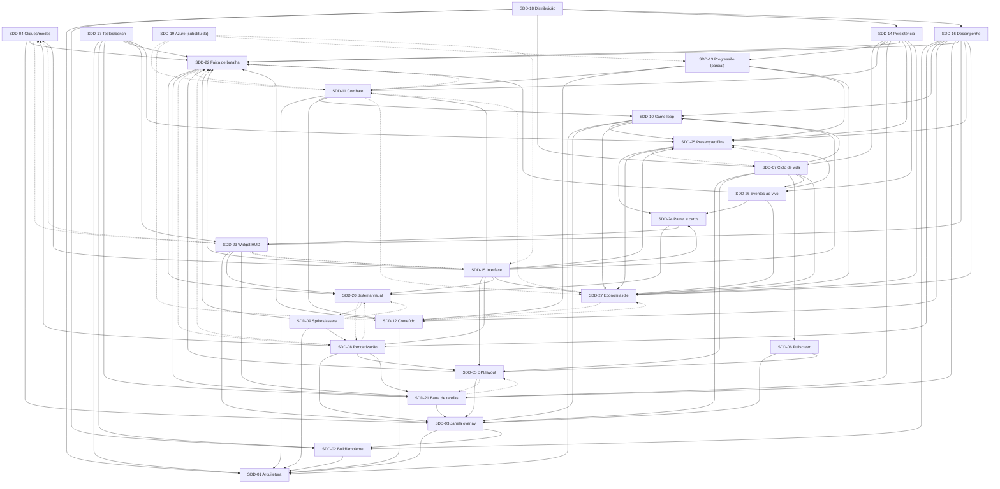

# specs/ — Índice geral das especificações (SideWar Desktop)

## 1. Propósito do diretório

Este diretório guarda a **especificação completa** do SideWar Desktop: um **jogo idle que vive sobre a barra de tarefas do Windows 11** (C#/.NET 10, WPF, SkiaSharp e Win32), com o **design oficial "Azure Defense"** (ADR-018). Ele reúne a análise da referência, as decisões de arquitetura, as fichas SDD, o plano de execução, evidências e checklists manuais.

Resumo do escopo atual (rev. **ADR-034**, 2026-11-13): cena de batalha acima da barra e **torres dentro da barra de tarefas, em posição livre em X** nas zonas livres ao lado dos ícones, lidas por UI Automation (SDD-21, SDD-22), modo construção a partir do Arsenal, widget HUD compacto à direita, acima da barra (SDD-23), painel de 4 abas e cards (SDD-24), presença Presente/Ausente/Offline com retorno offline analítico (SDD-25), eventos ao vivo com perguntas Azure (SDD-26) e economia idle (SDD-27). A consolidação da **ADR-031** (remoção do 2×, acerto instantâneo, configurações editáveis) está sendo aplicada às fichas e é considerada decidida.

**Regra central: as specs são a fonte da verdade. O executor (Sonnet ou Haiku) não decide arquitetura: quando encontra uma lacuna, uma contradição ou algo que a ficha não cobre, para e reporta.** Mudanças de arquitetura exigem uma nova ADR em [DECISOES.md](DECISOES.md), aprovada pelo usuário.

**Regra de ambiente (CLAUDE.md da raiz):** o projeto e todos os workers do tmux rodam **sempre com `claude2` ou `codex`**; `claude` (Claude Team) é errado e exige parar e reabrir.

Documentos principais:

- [ANALISE-SIDEWARAZ.md](ANALISE-SIDEWARAZ.md): análise do jogo de referência (SideWarAZ).
- [DECISOES.md](DECISOES.md): ADR-001..034 (ADR-034 substitui ADR-020: torres dentro da barra com posição livre em X; suas questões abertas são as DP-33.x de SDD-21, aceitas pelo Tech Lead em 2026-11-13) e decisões pendentes D-01..D-18 (D-16 e D-17 resolvidos por ADR-034; D-18 aguarda aprovação).
- [PLANO.md](PLANO.md): plano de execução (Fase 3): riscos, etapas E0..E8 e tarefas.

## 2. Convenções

### 2.1 Status de uma ficha

| Status | Significado |
|---|---|
| Rascunho para revisão | Escrita, ainda não revisada pelo usuário. Não deve ser executada. |
| Aprovada | Revisada e liberada para execução. |
| Em execução | Há tarefas da ficha em andamento. |
| Concluída | Todos os CA da ficha atendidos, com evidência registrada. |
| Proposta bloqueada | Depende de decisão pendente e não pode ser executada. |
| Substituída | Trocada por outra ficha ou ADR; o texto fica como histórico (ex.: SDD-19). |

### 2.2 Identificadores

| Prefixo | Significado | Exemplo |
|---|---|---|
| `RF-<ficha>.<n>` | Requisito funcional | RF-03.4 |
| `RNF-<ficha>.<n>` | Requisito não funcional | RNF-03.1 |
| `CA-<ficha>.<n>` | Critério de aceitação | CA-03.2 |
| `T<etapa>.<n>` | Tarefa do plano (um commit) | T1.3 |
| `T-<ficha>.<n>` | Teste automatizado descrito na ficha | T-04.1 |
| `MTC-<ficha>.<n>` | Item de checklist manual no Windows | MTC-21.8 |
| `P-<nn>` | Meta de desempenho (SDD-16) | P-04 |
| `ADR-<nnn>` / `D-<nn>` / `DP-<ficha>.<n>` | Decisão aceita / decisão pendente do usuário / decisão pendente local da ficha | ADR-001, D-05, DP-21.1 |

### 2.3 Rótulos de meta de desempenho

Toda meta numérica é **não comprovada** até medição. Só são permitidos três rótulos:

- **não medido**: estado inicial;
- **medido aprovado**: medido no Windows de referência (D-05) e dentro da meta;
- **medido reprovado**: medido e fora da meta (exige correção ou ADR de revisão).

Nada é declarado "passou no Windows" sem evidência. Resultados no Linux nunca valem para comportamento de Windows.

### 2.4 Evidências e checklists

- Evidência por etapa: `specs/evidencias/E<n>.md` (TRX Linux e Windows, MTC preenchido, benchmarks e matriz de rastreabilidade CA → teste/MTC). Dados de desempenho em `specs/evidencias/perf/` e de benchmark em `specs/evidencias/bench/`.
- Checklists manuais: `specs/mtc/MTC-<ficha>.md`, com a tabela `ID | passos | esperado | resultado | evidência | data | build` (SDD-17, RF-17.6).

## 3. Tabela-índice das fichas

Dados extraídos dos cabeçalhos reais de cada ficha (Status, Etapa, Depende de e Bloqueia, como declarados; textos de "revisada pelo design idle" omitidos). "Status" é o declarado no cabeçalho; a SDD-19 aparece como **Substituída**.

| ID | Arquivo | Título | Etapa | Depende de | Bloqueia | Status |
|---|---|---|---|---|---|---|
| SDD-01 | [SDD-01-arquitetura.md](SDD-01-arquitetura.md) | Arquitetura da solução | E0 | nenhuma | todas | Rascunho para revisão |
| SDD-02 | [SDD-02-build-ambiente.md](SDD-02-build-ambiente.md) | Build, ambiente WSL/Windows e estratégia de execução | E0 | SDD-01 | E1 em diante (E3 depende só de E0) | Rascunho para revisão |
| SDD-03 | [SDD-03-janela-overlay.md](SDD-03-janela-overlay.md) | Janela do overlay, GameThread e integração Win32 base | E1 (MVP técnico) | SDD-01, SDD-02 | SDD-04, 05, 06, 07, 08, 10, 15, 21, 22, 23 | Rascunho para revisão |
| SDD-04 | [SDD-04-transparencia-cliques.md](SDD-04-transparencia-cliques.md) | Transparência, passagem de cliques e modos de interação | E1 | SDD-03, SDD-22 (contrato de alfa e opacidade), SDD-23 (widget) | SDD-15, SDD-22, SDD-23 | Rascunho para revisão |
| SDD-05 | [SDD-05-dpi-monitores-docking.md](SDD-05-dpi-monitores-docking.md) | DPI, múltiplos monitores e acoplamento (docking) | E1 | SDD-03, SDD-21, SDD-22 | SDD-08, 15, 21, 22, 23 | Rascunho para revisão |
| SDD-06 | [SDD-06-deteccao-fullscreen.md](SDD-06-deteccao-fullscreen.md) | Detecção de fullscreen e visibilidade automática | E2 | SDD-03, SDD-05 | SDD-07 (completo) | Rascunho para revisão |
| SDD-07 | [SDD-07-ciclo-de-vida.md](SDD-07-ciclo-de-vida.md) | Ciclo de vida: ocultar e retornar, inatividade, energia, sessão, instância única e encerramento seguro | E2 | SDD-03, 05, 06, 10 (motivos de pausa), SDD-25 (presença e offline), SDD-26 (eventos ao vivo), SDD-27 (economia idle) | SDD-14 (gatilhos de save), SDD-18, SDD-25 | Rascunho para revisão |
| SDD-08 | [SDD-08-renderizacao.md](SDD-08-renderizacao.md) | Renderização (Skia → DIB → janela layered) | E1 (superfície + quadro de teste) e E4 (cena completa) | SDD-03, 04, 05, 20, 21, 22 | SDD-09, 15, 16, 22, 23, 24 | Rascunho para revisão |
| SDD-09 | [SDD-09-sprites-assets.md](SDD-09-sprites-assets.md) | Sprites, atlas e pipeline de assets | E4 (o placeholder entra na E1) | SDD-01, SDD-08, SDD-20, SDD-22 | SDD-15 (visual final), SDD-22, SDD-23, SDD-24 | Rascunho para revisão |
| SDD-10 | [SDD-10-game-loop-estados.md](SDD-10-game-loop-estados.md) | Game loop, relógio, política de render e máquinas de estado do jogo | E1 (laço + política) e E3 (integração com a simulação) | SDD-01, SDD-03, SDD-25, SDD-27 | SDD-07, 11, 13, 15, 16, 22, 25, 26 | Rascunho para revisão |
| SDD-11 | [SDD-11-combate.md](SDD-11-combate.md) | Simulação de combate (núcleo determinístico) | E3 | SDD-01, SDD-10, SDD-12 (valores), SDD-22, SDD-27 | SDD-13, 14, 15, 25, 26 | Rascunho para revisão |
| SDD-12 | [SDD-12-torres-inimigos-ondas.md](SDD-12-torres-inimigos-ondas.md) | Conteúdo: mapa em faixa, torres, inimigos, ondas e chefes | E3 | SDD-01, SDD-22, SDD-27 | SDD-11, 13, 25, 26, 27 | Rascunho para revisão |
| SDD-13 | [SDD-13-progressao.md](SDD-13-progressao.md) | Progressão: economia, experiência, fases, estrelas e checkpoint | E6 (o stub da economia entra na E3) | SDD-11, SDD-12, SDD-27 (economia, modos, catálogo, estrelas, checkpoint e seed), SDD-25 (multiplicador de presença) | SDD-14 (perfil), SDD-15 (SDD-24 para o painel de Fases) | Rascunho para revisão; parcialmente substituída por SDD-27 (ADR-019) |
| SDD-14 | [SDD-14-persistencia.md](SDD-14-persistencia.md) | Persistência (configurações, perfil e sessão) | E6 (o SettingsStore entra na E2) | SDD-07, 11, 13 (apenas o `stageTopic` e o `Profile` ajustado), 21 (posição das torres e `SEM POSIÇÃO`, ADR-034; antes `slotIndex`, `SEM SLOT`), 22 (layout da faixa), 25 (presença, offline, pendências), 26 (ledger e eventos), 27 (economia, Reservas, regiões, missões) | SDD-18 | Rascunho para revisão |
| SDD-15 | [SDD-15-interface-controles.md](SDD-15-interface-controles.md) | Interface e controles (HUD Skia, gestos, atalhos, bandeja e janelas WPF) | E5 (a bandeja e a hotkey mínimas entram na E1) | SDD-04, 05, 08, 10, 11, 20, 22, 23, 24, 25, 27 (SDD-13 deixou de ser dependência: a CampaignWindow foi substituída) | E6 | Rascunho para revisão |
| SDD-16 | [SDD-16-desempenho.md](SDD-16-desempenho.md) | Desempenho: metas mensuráveis, orçamento, instrumentação e otimizações obrigatórias | transversal (medição desde a E1; comprovação na E7) | SDD-02, 08, 10, 12, 21, 22, 23, 25, 27 | a aprovação de cada etapa com metas | Rascunho para revisão |
| SDD-17 | [SDD-17-testes-benchmarks.md](SDD-17-testes-benchmarks.md) | Testes automatizados, benchmarks e checklists manuais | transversal | SDD-01, SDD-02, SDD-21, SDD-22, SDD-23, SDD-25 (fixtures, goldens e relógio falso das fichas idle) | a aprovação de todas as etapas | Rascunho para revisão |
| SDD-18 | [SDD-18-distribuicao.md](SDD-18-distribuicao.md) | Distribuição da aplicação | E8 (o ZIP interno já é usável na E5 para playtest) | SDD-01, 02, 07, 14, 16 | release | Rascunho para revisão |
| SDD-19 | [SDD-19-modulo-azure.md](SDD-19-modulo-azure.md) | Módulo educativo Azure: escalabilidade e perguntas de chefe | E9 (pós-MVP) (histórico; as partes reaproveitadas entram na E6 via SDD-26) | SDD-11, SDD-12, SDD-13, SDD-15 (histórico; reaproveitado por SDD-26: ver abaixo) | nada | Substituída (por ADR-024 / SDD-26) |
| SDD-20 | [SDD-20-sistema-visual.md](SDD-20-sistema-visual.md) | Sistema visual "Azure Defense": tokens, tipografia, ícones e animações | E4 | SDD-08, SDD-09 | SDD-22, 23, 24 | Rascunho para revisão |
| SDD-21 | [SDD-21-integracao-barra-de-tarefas.md](SDD-21-integracao-barra-de-tarefas.md) | Integração com a barra de tarefas (TaskbarLayout, slots de torre e fallback) | E1 (MVP técnico; faz parte dele como risco a validar) | SDD-03, SDD-05 | SDD-22, SDD-23 | Rascunho para revisão |
| SDD-22 | [SDD-22-faixa-de-batalha.md](SDD-22-faixa-de-batalha.md) | Faixa de batalha (janela de cena sobre a barra de tarefas, mundo 1D e sprites do design) | E1 (janela) e E4 (cena) | SDD-20, SDD-21, SDD-08, SDD-11 | SDD-25, SDD-26 | Rascunho para revisão |
| SDD-23 | [SDD-23-widget-hud.md](SDD-23-widget-hud.md) | Widget HUD sobre a barra de tarefas | E5 | SDD-20, SDD-21, SDD-04, SDD-03 (RF-03.9: janela owned pela faixa), SDD-15 (menu nativo) | SDD-24 | Rascunho para revisão |
| SDD-24 | [SDD-24-painel-e-cards.md](SDD-24-painel-e-cards.md) | Painel de 4 abas e cards (pergunta do chefe e "Bem-vindo de volta") | E5 | SDD-20, SDD-23 | SDD-25, SDD-26 (visuais) | Rascunho para revisão |
| SDD-25 | [SDD-25-presenca-e-offline.md](SDD-25-presenca-e-offline.md) | Presença (Presente, Ausente, Offline), auto-escala e retorno offline analítico | E6 | SDD-07, SDD-27, SDD-24 | SDD-26 | Rascunho para revisão |
| SDD-26 | [SDD-26-eventos-ao-vivo.md](SDD-26-eventos-ao-vivo.md) | Eventos ao vivo: pico de demanda, chefe com pergunta Azure e caixas de suprimentos | E6 | SDD-22, SDD-24, SDD-25, SDD-27 | nada (o estado persistido entra em SDD-14) | Rascunho para revisão |
| SDD-27 | [SDD-27-economia-idle.md](SDD-27-economia-idle.md) | Economia idle: créditos, torres, ondas automáticas, fases, missões e prestígio | E3 (núcleo da economia e do combate idle) e E6 (missões, regiões e prestígio) | SDD-11, SDD-12 | SDD-25, SDD-26 | Rascunho para revisão |

Observações sobre a tabela:

- As fichas SDD-20 a SDD-27 são as do design idle (ADR-018 a ADR-030). SDD-03, 04, 05, 08, 09, 10, 11, 12, 14, 15, 16 e 17 foram revisadas por elas; SDD-13 é parcialmente substituída por SDD-27 e SDD-19 é histórica (aproveitam-se o banco de perguntas e o ledger via SDD-26).
- Os cabeçalhos declaram **dependências mútuas** (por exemplo SDD-05 ⇄ SDD-21, SDD-08 ⇄ SDD-22, SDD-07 ⇄ SDD-25). Elas são arestas tracejadas no grafo e são resolvidas pelo **corte por etapa** do [PLANO.md](PLANO.md) (cada ficha entra por partes).

## 4. Grafo de dependências

Setas apontam de quem depende para a dependência (A → B significa "A depende de B"), conforme os cabeçalhos. Linhas **tracejadas** indicam dependência mútua declarada nos dois cabeçalhos (resolvida por corte de etapa) ou a ficha substituída (SDD-19).

## 5. Fonte visual

O design oficial (ADR-018) é o artefato **"Azure Defense — Idle de barra"**:

- Link: <https://claude.ai/artifact/4cgwgCrocRoYpYEcmzeTF5>
- Arquivos do design: `Main.dc.html`, `Strip.dc.html`, `Presence.dc.html`, `Offline.dc.html`. Os valores foram transcritos para [SDD-20-sistema-visual.md](SDD-20-sistema-visual.md), que é a **única fonte** de tokens; onde SDD-20 e uma ficha antiga divergirem, SDD-20 vence.

Mapa artboard → ficha:

| Artboard | Fichas |
|---|---|
| Strip (faixa de batalha) | [SDD-22](SDD-22-faixa-de-batalha.md), [SDD-23](SDD-23-widget-hud.md) |
| Main (painel) | [SDD-24](SDD-24-painel-e-cards.md) |
| Presence (presente, ausente, eventos) | [SDD-25](SDD-25-presenca-e-offline.md), [SDD-26](SDD-26-eventos-ao-vivo.md), [SDD-24](SDD-24-painel-e-cards.md) |
| Offline ("Bem-vindo de volta") | [SDD-24](SDD-24-painel-e-cards.md), [SDD-25](SDD-25-presenca-e-offline.md) |

## 6. Links

- Análise da referência: [ANALISE-SIDEWARAZ.md](ANALISE-SIDEWARAZ.md)
- Decisões e ADRs: [DECISOES.md](DECISOES.md)
- Plano de execução: [PLANO.md](PLANO.md)
- Fonte visual: <https://claude.ai/artifact/4cgwgCrocRoYpYEcmzeTF5>
